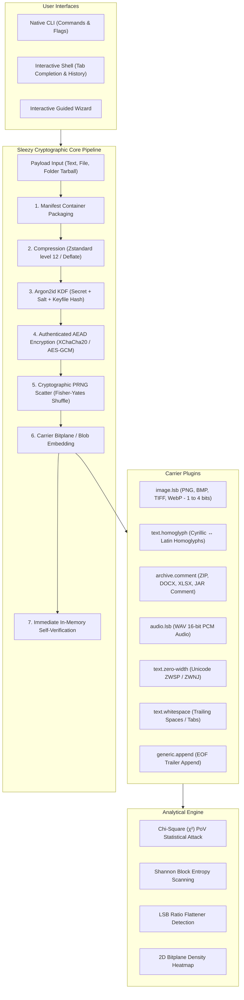
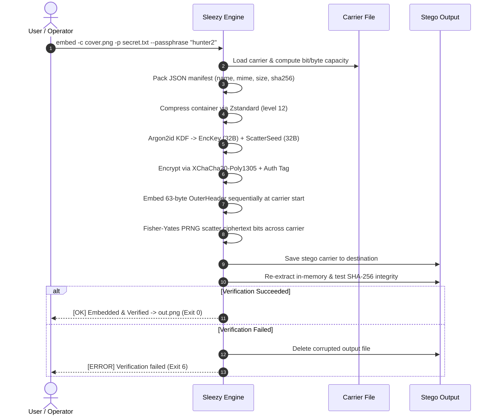
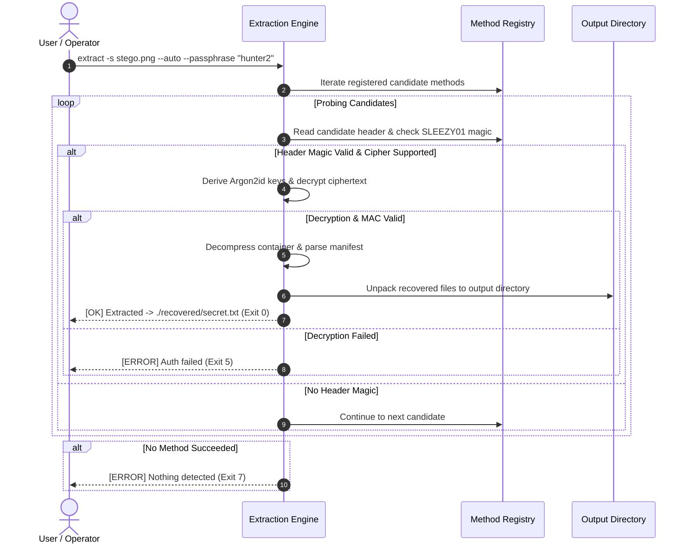

# Sleezy: Modular Steganography Workbench & Cryptographic Steganalysis Suite

<div align="center">

```text
   _____ __                            
  / ___// /__  ___  ____  __  __       
  \__ \/ / _ \/ _ \/_  / / / / /       
 ___/ / /  __/  __/ / /_/ /_/ /        
/____/_/\___/\___/ /___/\__, /         
                       /____/          
```

### *The Modular Steganography Workbench & Cryptographic Steganalysis Suite*
**v1.2.0 • Local-Only • Zero-Telemetry • Multi-Carrier Cryptographic Engine**

[](https://python.org)
[](SECURITY.md)
[](SECURITY.md)
[](LICENSE)

[Architecture](#-system-architecture) •
[Workflows](#-core-workflows) •
[Features](#-key-features) •
[Carrier Methods](#-carrier--method-matrix) •
[Quick Start](#-quick-start) •
[Interactive CLI](#-interactive-terminal-workbench) •
[Steganalysis](#-steganalysis-engine) •
[Profiles](#-profile-presets) •
[Security Hardening](#-security-hardening) •
[Test Suite](#-automated-testing)

</div>

---

## 📖 Executive Summary

Existing steganography utilities generally fall into two extremes: command-line tools like *steghide*, *zsteg*, and *OpenStego* are capable but rigid, supporting only one or two file formats with conflicting command grammars; while typical GUI tools are shallow wrappers around 1-bit PNG LSB embedding.

**Sleezy bridges this divide:**
- **One Engine, Many Carriers**: Every carrier format and embedding algorithm operates as a plugin behind a unified, authenticated pipeline.
- **Privacy by Default**: 100% local processing. No telemetry, no cloud dependencies, and zero network calls.
- **Defense in Depth**: Authenticated encryption (`XChaCha20-Poly1305` or `AES-256-GCM`), memory-hard key derivation (`Argon2id`), and keyed PRNG scatter positions defeat sequential statistical detectors.
- **Hardened Container Security**: Built-in protection against path traversal, zip/tar-slip, decompression bombs, and timing attacks on digest comparisons.
- **Dual-Mode Steganalysis & Integrity**: Includes an advanced analytical engine featuring Chi-Square ($\chi^2$) PoV analysis, Shannon sliding block entropy, LSB ratio deviation, and 2D ASCII bitplane density heatmaps.
- **Fail-Safe Self-Verification**: Every embed operation automatically executes an immediate in-memory re-extraction and SHA-256 checksum verification before the output file is written to disk.

---

## 🏛️ System Architecture



---

## 🔄 Core Workflows

### 1. Payload Embedding Pipeline

The diagram below illustrates how raw payloads are securely wrapped, compressed, encrypted, scattered, and verified before writing to disk:



### 2. Auto-Detect Extraction Workflow

When extracting without specifying the embedding method, Sleezy intelligently probes candidate plugins:



---

## ✨ Key Features

- 💎 **Italic ASCII Slant Branding**: High-contrast, styled terminal greeting with live system diagnostics and quick tips.
- 🐚 **Interactive REPL Shell**: Run `python sleezy.py` to enter a persistent interactive command console with command history and Tab autocompletion for commands and filesystem paths.
- 🧙 **Interactive Guided Wizard**: Type `wizard` for a guided, prompt-based walkthrough that assists non-technical users in selecting carriers, configuring payloads, previewing detectability, and generating commands.
- 🗜️ **Adaptive Compression**: Automatically compresses payloads using **Zstandard** (compression level 12) with graceful fallback to Deflate.
- 🛡️ **Military-Grade Cryptography**: 
  - Authenticated encryption via **XChaCha20-Poly1305** (default) or **AES-256-GCM**.
  - Password-based key derivation using memory-hard **Argon2id** (64 MiB default).
  - Multi-factor **Keyfile support** (`--keyfile`) mixing hardware/file entropy into the KDF.
- 🎲 **Cryptographic PRNG Scatter**: Keyed PRNG selects non-contiguous embedding slots across carrier media, defeating sequential-LSB detection algorithms.
- 📊 **Real-Time Capacity & Detectability Scoring**: Displays embedding rate gauges, risk assessments (`[LOW]`, `[MEDIUM]`, `[HIGH]`), and recommendations before embedding.
- 🔍 **Analytical Steganalysis Suite**:
  - $\chi^2$ (Chi-Square) attack detecting artificial LSB pair equalization.
  - Shannon entropy scanning per byte and sliding block windows.
  - 2D ASCII bitplane density visualizer (`--bitplane`).
  - Structural inspections (PNG ancillary chunks, ZIP comments, EOF trailers).
- ⚙️ **Saved Profiles**: Built-in mission presets (`ctf-quick`, `max-stealth`, `max-capacity`, `watermark`, `covert-text`) plus custom profile creation.
- 📦 **Batch Automation**: Batch embed or extract across directories using glob patterns.
- 🏷️ **Provenance Watermarking**: Embed and verify tamper-evident author provenance watermarks.

---

## 📦 Carrier & Method Matrix

| Method ID | Target Formats | Engine Mode | Description | Robustness | Risk Baseline |
|---|---|---|---|---|---|
| `image.lsb` | PNG, BMP, TIFF, WebP | Bitplane | Configurable 1 to 4 bits/channel, keyed PRNG scatter | None | Medium |
| `text.homoglyph` | TXT, MD, HTML, Source code | Bitplane | Invisible Latin ↔ Cyrillic homoglyph substitution | High (Formatting) | Low |
| `archive.comment`| ZIP, DOCX, XLSX, PPTX, JAR | Blob | Standard ZIP comment container | None | Medium |
| `audio.lsb` | WAV (16-bit PCM) | Bitplane | 1 bit per audio sample, keyed PRNG scatter | None | Low |
| `text.zero-width` | TXT, MD, HTML | Bitplane | ZWSP (`\u200b`) & ZWNJ (`\u200c`) insertion | None | Low |
| `text.whitespace` | TXT, MD, HTML | Bitplane | Trailing space and tab encoding per line | None | Medium |
| `generic.append` | Any binary file | Blob | EOF trailer append (`SLZTRAIL`) fallback | None | High |

---

## ⚡ Quick Start

### Installation

```bash
# Clone the repository
git clone https://github.com/exsploiter/Sleezy.git
cd Sleezy

# Install dependencies
pip install -r requirements.txt
```

### Essential Commands

```bash
# 1. Start interactive shell with italic banner & autocomplete
python sleezy.py

# 2. Run the guided step-by-step wizard
python sleezy.py wizard

# 3. Embed a secret file into a cover image using 2 bits/channel
python sleezy.py embed -c cover.png -p secret.txt --bits 2 -o stego.png

# 4. Embed invisible text into an essay using Unicode homoglyphs
python sleezy.py embed -c essay.txt -t "CTF{covert_homoglyph}" -m text.homoglyph -o stego.txt

# 5. Embed a secret inside an Office document or ZIP archive
python sleezy.py embed -c project.docx -p payload.bin -m archive.comment -o stego.docx

# 6. Extract payload with automatic method detection
python sleezy.py extract -s stego.png -o ./recovered --auto

# 7. Run statistical steganalysis with 2D bitplane ASCII preview
python sleezy.py analyze suspicious.png --bitplane

# 8. Verify SHA-256 hash or watermark
python sleezy.py verify stego.png
```

---

## 💻 Interactive Terminal Workbench

Starting Sleezy without arguments opens the full-featured interactive REPL:

```text
   _____ __                            
  / ___// /__  ___  ____  __  __       
  \__ \/ / _ \/ _ \/_  / / / / /       
 ___/ / /  __/  __/ / /_/ /_/ /        
/____/_/\___/\___/ /___/\__, /         
                       /____/          
   The Modular Steganography Workbench & Steganalysis Suite
   v1.2.0 • Local-Only • Zero-Telemetry • Multi-Carrier Pipeline

┌─ SYSTEM DIAGNOSTICS ───────────────────────────────────────────┐
│ • KDF Engine:      Argon2id (64 MiB default)                   │
│ • Ciphers:         XChaCha20-Poly1305 ✓, AES-256-GCM ✓         │
│ • Compression:     Zstandard ✓, Deflate ✓                      │
│ • Image Engine:    Pillow + NumPy ✓ (lossless PNG/BMP/TIFF)    │
│ • Steganalysis:    SciPy χ² p-values ✓                         │
│ • Carrier Plugins: 7 active plugins loaded                     │
└────────────────────────────────────────────────────────────────┘

  Type 'wizard' for guided mode, 'help' for commands, or 'exit' to quit.

sleezy ❯ 
```

### Shell Commands Cheatsheet

| Command | Action | Example |
|---|---|---|
| `wizard` | Step-by-step guided assistant | `wizard` |
| `embed` | Embed payload into carrier | `embed -c img.png -t "msg" -o out.png` |
| `extract` | Recover payload from carrier | `extract -s out.png -o ./recovered` |
| `analyze` | Run statistical & structural steganalysis | `analyze cover.png --bitplane` |
| `methods` | Table of registered carrier plugins | `methods --family image` |
| `formats` | List supported carrier format extensions | `formats` |
| `profile` | List and inspect mission presets | `profile list` |
| `batch` | Bulk embed or extract across folders | `batch embed --glob "covers/*.png" -p data.txt -o out/` |
| `verify` | Check SHA-256 or provenance watermark | `verify out.png` |
| `clear` | Clear terminal screen | `clear` |
| `exit` | Quit Sleezy shell | `exit` |

---

## 🔬 Steganalysis Engine

The `analyze` subcommand executes multiple orthogonal heuristic and statistical tests:

```bash
python sleezy.py analyze sample.png --bitplane
```

Sample output:
```text
┌─ STEGANALYSIS INSPECTION REPORT ───────────────────────────────┐
│ • File:            sample.png (12,420 bytes)                   │
│ • Format Family:   image (64x64 RGB)                           │
│ • LSB Deviation:   0.4954 (near 0.5000)                        │
│ • Chi-Square (χ²): 86.48 (degrees of freedom: 128, p=0.9981)   │
│ • Entropy:         7.84 bits/byte                              │
│ • Suspicion Score: [HIGH RISK 75/100] ("suspicion_score": 75)  │
│ • Finding:         High χ² p-value strongly suggests stego     │
└────────────────────────────────────────────────────────────────┘

Bitplane LSB Visual Density:
▓▒▒▒░░▓▒▒░▒░░▒█▒░▒░▒▒░▒▒▓▒▒▒▓ ░▒▒░░▒░▒░░▓▒░▓▒▒█▒
▓▓░░░░░▒▓░ ░▓▒░▒ ▓▒█░▓▓░▒▒▒█▓▓▓▓ ▓▓▓▓▒██▒░▒░▓▓▓▒
░▓░░█▓░▓▒░▓▒░▓▒░▓░█▒░▒░░░▒▒▓▒░▒▓░░░▓▒░ █░░█▒▒▒░▓
▓▒▒▒▒ ▒▒░▒▓▓▓▒▒▒░▓▓░░▒ ▒▓▒▓▓░░▒▓▓░▓▓▓▒░▒▒░▓▒█▒░▓
```

---

## 📑 Profile Presets

Use `--profile <name>` to instantly configure pipeline parameters:

| Profile | Cipher | Compression | KDF Settings | Bits/Channel | Mission Focus |
|---|---|---|---|---|---|
| `ctf-quick` | AES-256-GCM | Deflate | 16 MiB, 1 iter | 1 bit | Maximum speed in CTFs |
| `max-stealth` | XChaCha20-Poly1305 | Zstd-12 | 128 MiB, 4 iter | 1 bit (scattered) | Maximum statistical undetectability |
| `max-capacity`| XChaCha20-Poly1305 | Zstd-12 | 64 MiB, 3 iter | 4 bits | Maximum payload storage |
| `watermark` | AES-256-GCM | Zstd-12 | 32 MiB, 2 iter | 1 bit | Provenance metadata tags |
| `covert-text` | XChaCha20-Poly1305 | Zstd-12 | 64 MiB, 3 iter | Homoglyphs | Invisible plain text hiding |

---

## 🛡️ Security Hardening

Sleezy incorporates comprehensive security controls designed to resist attacks from adversarial carriers and malformed stego objects:

1. **Path Traversal & Tar-Slip Defense**: All extracted payload filenames are strictly sanitized to strip directory traversal sequences (`..`), leading slashes, and reserved Windows device names (`CON`, `PRN`, `AUX`, `NUL`, `COM1-9`, `LPT1-9`). Tar members are validated to guarantee no paths or symlinks escape the destination directory.
2. **Anti-DoS KDF Bounds**: The outer header unpacker enforces sanity checks on Argon2 parameters (`time_cost` $\le$ 32, memory exponent $\le$ 24, parallelism $\le$ 64) to prevent adversarial CPU/RAM exhaustion attacks during extraction.
3. **Decompression Bomb Protection**: Both `deflate` and `zstandard` decompression engines enforce strict 2 GiB output bounds (`max_length` and `max_output_size`), defending against memory explosion attacks.
4. **Side-Channel Resistant Comparisons**: All checksum verifications and container manifest integrity checks use constant-time `hmac.compare_digest` to prevent timing leak vulnerabilities.
5. **Profile Injection Prevention**: Custom profile names are validated using strict alphanumeric patterns (`^[a-zA-Z0-9_\-]+$`), completely blocking arbitrary file access or deletion via profile flags.
6. **Isolated Ephemeral Verification**: Self-verification occurs inside isolated OS temporary directories (`tempfile.TemporaryDirectory`) rather than writing unencrypted temporary files to user working paths.
7. **Stream-Hashed Keyfiles**: Keyfiles are hashed using fixed 64 KiB chunks, enabling arbitrary keyfile sizes without risk of out-of-memory crashes.

---

## 🧪 Automated Testing

Sleezy ships with an automated test suite verifying round-trip integrity, tamper resistance, and edge cases across every method:

```bash
python test_sleezy.py
```

```text
PASS: image.lsb round-trip (secret.txt)
PASS: image.lsb round-trip (zero.bin)
PASS: audio.lsb round-trip (secret.txt)
PASS: audio.lsb round-trip (zero.bin)
PASS: text.zero-width round-trip (secret.txt)
PASS: text.zero-width round-trip (zero.bin)
PASS: text.whitespace round-trip (secret.txt)
PASS: text.whitespace round-trip (zero.bin)
PASS: generic.append round-trip (secret.txt)
PASS: generic.append round-trip (zero.bin)
PASS: wrong passphrase -> exit 5
PASS: --auto detection succeeds
PASS: dry-run leaves no output file
PASS: oversized payload -> exit 3
PASS: multi-file folder payload (tar)
PASS: tampered header -> exit 7 (nothing detected)
PASS: methods --json runs
PASS: analyze runs on image
PASS: verify prints sha256
PASS: text.homoglyph round-trip
PASS: archive.comment round-trip
PASS: profile list runs
PASS: analyze --bitplane includes bitplane_ascii

23 passed, 0 failed
```

---

## 🚦 Standard Exit Codes

| Code | Constant | Meaning |
|---|---|---|
| `0` | `EXIT_OK` | Operation completed successfully |
| `1` | `EXIT_ERR` | General runtime error |
| `2` | `EXIT_BADARGS` | Invalid arguments or missing inputs |
| `3` | `EXIT_TOO_LARGE` | Payload size exceeds carrier capacity |
| `4` | `EXIT_UNSUPPORTED` | Unsupported carrier format or method |
| `5` | `EXIT_AUTH_FAILED` | Authentication / decryption failed (wrong passphrase/keyfile) |
| `6` | `EXIT_VERIFY_FAILED` | In-memory verification failed after embedding |
| `7` | `EXIT_NOTHING_FOUND` | No valid Sleezy header / trailer detected |

---

## ⚖️ Responsible Use & Legal Notice

Steganography is a dual-use technology. Sleezy is engineered exclusively for lawful privacy protection, security research, digital forensics education, capture-the-flag (CTF) competitions, and provenance watermarking. The authors explicitly disclaim responsibility for unauthorized or unlawful use.

---

## 📄 License

Distributed under the [MIT License](LICENSE). Built for the community with ❤️.
